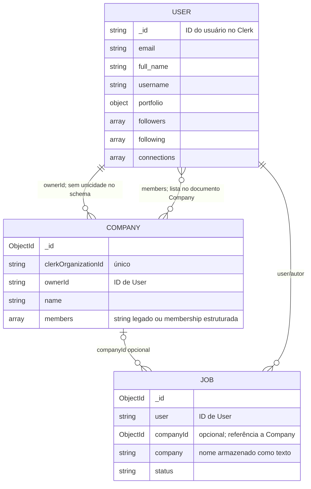

# Relatório técnico: usuários e empresas no ADAPT

**Escopo:** leitura da implementação atual no repositório, sem consulta aos dados de produção do MongoDB ou do Clerk. Este documento descreve o código encontrado; não confirma quantos usuários ou empresas existem no ambiente publicado.

## Resumo

- **Clerk** autentica as pessoas e mantém organizações. O identificador do usuário no Clerk é usado como `_id` do documento `User` no MongoDB.
- **MongoDB** mantém o perfil da pessoa no modelo `User` e o perfil corporativo no modelo `Company`.
- Uma empresa está vinculada a uma organização do Clerk por `clerkOrganizationId`, tem um `ownerId` e uma lista de `members`.
- A participação no ADAPT (`Company.members`) é separada da associação de organização do Clerk. Novas adesões recebem papel `viewer`; papéis de gestão são validados pelo backend.
- `Company.members` está em transição: leitores aceitam IDs antigos como strings e registros estruturados `{ userId, role, status, joinedAt }`.
- Novas vagas recebem `companyId`; jobs sem esse campo permanecem legados e só podem ser reconciliados sem usar o nome textual como prova.
- O código local ainda não foi comparado com dados de produção. A auditoria e migração são scripts explícitos; nenhum deles foi executado neste trabalho.

## Diagrama das relações

## Usuários

### Identidade e criação

- A autenticação é feita pelo Clerk.
- As rotas protegidas passam pelo middleware `protect`. Ele obtém o `userId` da sessão e chama `findOrCreateAuthenticatedUser`.
- Se ainda não houver registro no MongoDB, o servidor consulta o usuário no Clerk e cria `User` com `_id = userId`, e-mail, nome, imagem e username gerado a partir do e-mail/nome. O username recebe sufixo numérico se já estiver ocupado.
- O middleware coloca o documento carregado/criado em `req.dbUser`.

### Dados persistidos (`server/models/User.js`)

- Identificação: `_id` (string, ID Clerk), `email`, `full_name`, `username`.
- Perfil: `bio`, `profile_picture`, `cover_photo`, `location`.
- Portfólio: linguagens, bibliotecas, frameworks e dados do currículo (`url`, `fileName`).
- Aprendizado: progresso de cursos, status `want` / `in_progress` / `completed`, status de projeto e preferências de cargo/competências.
- Exclusividade empresarial em andamento: `companyOrgClaim` reserva atomicamente uma organização para novas sincronizações; `pendingCompanySync` guarda os dados para permitir retry após falha. Ambos são campos internos não selecionados por padrão.
- Relações sociais: arrays `followers`, `following` e `connections`, contendo referências a outros usuários.
- O schema usa timestamps do Mongoose.

### Operações principais

- `GET /api/user/data`: obtém o perfil atual.
- `POST /api/user/update`: atualiza perfil, portfólio e arquivos enviados.
- `POST /api/user/discover`: busca usuários por nome, username, e-mail, localização ou bio.
- Follow, unfollow, conexão, aceite e listagem de conexões usam rotas próprias em `/api/user`.
- Perfis de usuário são carregados por `POST /api/user/profiles`.

## Empresas

### Cadastro e sincronização

1. A interface `/empresa` usa Clerk `createOrganization` para criar uma organização, com nome e slug.
2. O frontend ativa essa organização e envia os dados corporativos a `POST /api/company/sync`.
3. O servidor exige autenticação e verifica no Clerk se o usuário é `org:admin` daquela organização. O nome e slug canônicos vêm da organização consultada no Clerk.
4. Se o `clerkOrganizationId` já estiver ligado a outro `ownerId`, a sincronização é recusada com conflito.
5. Uma reivindicação atômica em `User.companyOrgClaim` bloqueia requisições concorrentes que tentem vincular outra organização ao mesmo responsável. O payload pendente é salvo junto com essa reivindicação.
6. O servidor envia `app/company.upsert` ao Inngest. O upsert é repetível, recusa conflito de owner, ignora eventos antigos por timestamp e usa controle otimista de concorrência.
7. A rota confirma a persistência pelo `syncOperationId`. Em até quatro segundos sem confirmação responde `202` com estado pendente; o frontend permite retry sem criar outra organização. Após sucesso, o payload pendente é removido.

### Dados persistidos (`server/models/Company.js`)

- Identificadores: `_id` MongoDB, `clerkOrganizationId` obrigatório/único/indexado, `ownerId` string com referência a `User`.
- Perfil: nome, slug, setor, porte, localização, site, descrição, capa e logo.
- Dados de tecnologia: `technologies`, `frameworks` e certificações (`name`, `issuer`, `year`, `url`).
- Participação: `members`, array `Mixed` temporário com strings legadas ou `{ userId, role, status, joinedAt }`.
- Papéis: `owner` é derivado de `ownerId`; membro legado vira `viewer` no acesso; `admin`, `recruiter` e `viewer` têm permissões centralizadas em `server/services/companyAccess.js`.
- `clerkOrganizationId` tem índice único existente. `ownerId` continua sem índice único até auditoria e resolução dos conflitos de produção.
- O schema usa timestamps e concorrência otimista do Mongoose.

O schema não contém uma lista de empresas no `User`. O responsável é representado por `ownerId`, separadamente do papel da membership. O owner é reconhecido mesmo se não constar em `members`.

### Consulta, atualização e participação

- `GET /api/company/my`: retorna a única empresa gerenciável ou pede seleção explícita se a pessoa tem acesso de gestão a várias; owners com duplicidade recebem conflito para resolução manual.
- `POST /api/company/update`: aceita empresa selecionada, mas exige permissão `manageCompany`; logos e capas são enviadas ao ImageKit.
- `GET /api/company/list`: lista até 50 empresas, mais recentes primeiro, podendo filtrar por nome, setor ou localização. A resposta inclui `memberCount`, `isOwner` e `isMember` para o usuário da sessão.
- `GET /api/company/:companyId`: aceita ID MongoDB ou `clerkOrganizationId`, retorna membros normalizados e permissões do usuário autenticado.
- `POST /api/company/:companyId/join`: mantém o fluxo atual de adesão direta e atribui `viewer`.
- `POST /api/company/:companyId/members`, `PATCH .../members/:memberUserId`, `DELETE .../members/:memberUserId`: permitem gestores administrarem membros existentes; somente owner atribui ou altera admin.
- `GET /api/company/sync/pending`: permite recuperar, pela sessão autenticada, dados de sincronização pendente para retry.

## Vagas e vínculo com empresas

- O modelo `Job` tem `user` (autor/usuário), `companyId` (referência opcional a `Company`) e `company` (nome textual copiado para o documento), além dos campos da vaga.
- Comentário no schema indica que `companyId` é opcional por causa de documentos legados.
- A criação/atualização valida `manageJobs` no backend; owner, admin e recruiter podem gerenciar vagas. IDs e papéis enviados pelo cliente não concedem acesso.
- `/api/company/my` alimenta a interface de criação e retorna opções explícitas se houver mais de uma empresa gerenciável.
- `getMyJobs` inclui vagas das empresas gerenciáveis e vagas legadas autoradas pelo próprio usuário. Vagas com `companyId` verificam permissão da empresa antes de editar/excluir.
- Job legado sem `companyId` só pode ser vinculado durante edição se o autor autenticado possuir exatamente uma empresa; a associação não usa o campo textual `company`.
- Vagas publicadas são apresentadas publicamente; rascunhos pertencem ao fluxo administrativo da empresa.

## Pontos de atenção para uma próxima análise

1. **Conflitos reais de `ownerId`:** não foi criado índice único. Execute `npm run audit:companies -- --run-read-only-audit` somente no ambiente autorizado; resolva todos os donos com múltiplas empresas antes de planejar o índice.
2. **Referências legadas:** a auditoria precisa identificar owners/members ausentes, membership malformada/duplicada e vagas sem `companyId` ou com vínculo inválido. O script de migração não associa vagas por nome e bloqueia empresas com referências de membro inválidas.
3. **Migração:** primeiro faça backup restaurável e revise o dry-run. Aplicar memberships exige `--run-read-only-audit --apply --backup-confirmed`; nada foi migrado durante a implementação.
4. **Membros novos:** o fluxo existente de `join` continua autoentrada como `viewer`; não foram criados convites/aprovações. Confirmar futuramente se a política de entrada deve mudar.
5. **Vagas legadas ambíguas:** continuam visíveis para o autor, mas editar/excluir exige permissão inequívoca da empresa. A auditoria e eventual revisão manual devem resolver os casos bloqueados.
6. **Índice e compatibilidade:** a regra de uma empresa por responsável é aplicada às novas sincronizações por reivindicação atômica no documento `User`; os documentos antigos ainda podem conter conflitos e o índice único fica pendente da auditoria.
7. **Produção:** não houve conexão ao MongoDB/Clerk de produção, execução de migração, alteração de credenciais ou deploy.

## Arquivos de referência

- `server/models/User.js`
- `server/models/Company.js`
- `server/models/Job.js`
- `server/middlewares/auth.js` e `server/utils/authUser.js`
- `server/routes/userRoutes.js` e `server/controllers/userController.js`
- `server/routes/companyRoutes.js` e `server/controllers/companyController.js`
- `server/services/companyAuthorization.js`
- `server/services/companyAccess.js`, `server/services/companyOwnership.js`, `server/services/companySync.js`
- `server/scripts/auditCompanyData.js` e `server/scripts/migrateCompanyMembers.js`
- `server/inngest/index.js` (evento `app/company.upsert`)
- `Adapt_Frontend/src/pages/Empresa/components/CreateCompanyCard.jsx`
- `Adapt_Frontend/src/pages/CompanyProfile/CompanyProfile.jsx`
- `Adapt_Frontend/src/pages/jobCreation/JobCreation.tsx`
- `Adapt_Frontend/src/pages/CompanyProfile/CompanyMemberManagement.jsx`

## Prompt pronto para enviar ao ChatGPT

> Analise o relatório abaixo sobre a arquitetura atual de usuários, empresas e vagas do ADAPT. Primeiro, resuma o fluxo e as relações existentes sem presumir dados de produção. Depois, avalie os pontos de atenção, especialmente: se um usuário pode possuir várias empresas, como deve funcionar a entrada e autorização de membros, como sincronizar Clerk/MongoDB com segurança e como garantir que cada vaga esteja associada à empresa correta. Proponha uma arquitetura-alvo e um plano incremental de migração compatível com React, Node.js, Express, Clerk e MongoDB. Não invente requisitos; liste as decisões de produto que precisam ser confirmadas e identifique riscos de compatibilidade com dados legados. Relatório: [cole aqui o conteúdo integral deste arquivo].
